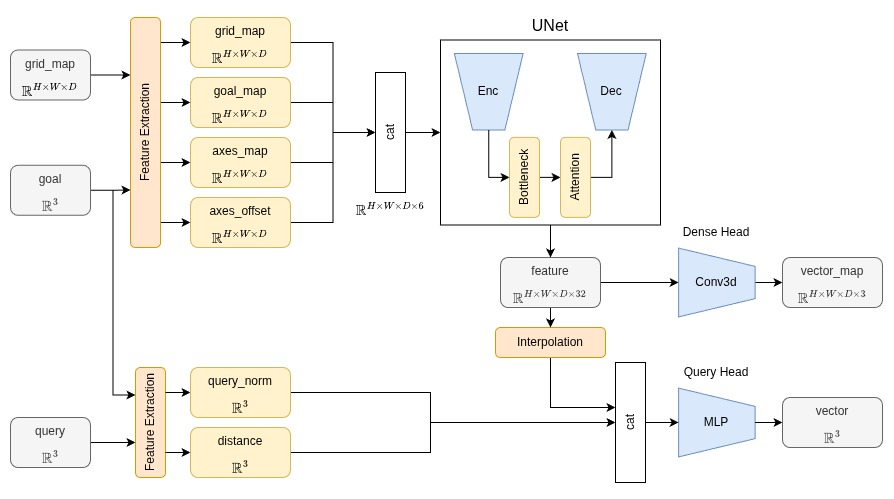

# Vacancy Flow Network (VaFlow-Net) for 2D/3D Mobile Robot Navigation

## Quick Start

From your workspace:

```bash
# 0. Optional: create the venv with a given name
export UV_PROJECT_ENVIRONMENT=env_vfn

# 1. Sync the project and install the GPU dependencies
uv sync --python 3.11 --extra gpu

# 2. Run a demo inside the managed environment
uv run python scripts/run_flow.py
# or
source env_vfn/bin/activate
python scripts/run_flow.py
```

## Project Structure

The repository contains one installable distribution with three Python
packages under `src/`, separated by dependency weight. Most of the stack comes
in a **2D** and a parallel **3D** flavor (3D types/functions are suffixed
`3D` / `_3d`; the 2D code is untouched):

- `pyproject.toml`: Packaging and dependency configuration
- `src/gridflow/`: Torch-free core library (numpy + matplotlib + scipy)
  - `src/gridflow/algorithms/`: 2D BFS, A*, water-flow, Eikonal, SDF, guidance
  - `src/gridflow/algorithms_3d/`: 3D counterparts (BFS3D, A*3D, WaterFlow3D, Eikonal3D, SDF3D, guidance)
  - `src/gridflow/utils/`: Plotting helpers, including 3D plots (`plot_grid_3d`, `plot_vector_field_3d`, ...)
- `src/gridflow_nn/`: Neural model + inference (needs `torch`)
  - `vector_field_net.py` / `vector_field_net_3d.py`: the `VectorFieldNet` / `VectorFieldNet3D` models
  - `inference.py` / `inference_3d.py`: `load_model` + `predict_full_field` (and 3D variants; lightweight, torch only)
  - `training/`: full training stack — `Trainer`, `dataloader/`, `configs/` (heavy tier; not imported unless you train)
- `src/gridflow_sim/`: Grid-world simulation (needs `torch`)
  - `simulator.py`: `GridFlowSimulator` (world / local-scan / flow-following logic)
  - `render.py`: `VideoRecorder` and rendering helpers (imported explicitly)
  - `configs/`: simulation `Config`
- `scripts/`: All runnable entry points (2D + 3D demos, dataset generation, training, simulation) — outside the packages
- `cache/`: Generated datasets (gitignored, regenerable)
- `models/`: Saved model checkpoints (`.pt`) + per-run tensorboard logs

## Requirements

- Python `>=3.11`
- Core (`gridflow`): `numpy`, `matplotlib`, `scipy`, `tensorboard`
- Model / training / simulation (`gridflow_nn`, `gridflow_sim`): the pinned
  PyTorch 2.7.0 CUDA 12.8 stack installed by the `gpu` extra

## Running Scripts

### Library demos

2D:

```bash
python scripts/run_bfs.py
python scripts/run_flow.py
python scripts/run_astar.py
python scripts/run_eikonal.py
python scripts/run_sdf.py
```

3D:

```bash
python scripts/run_bfs_3d.py
python scripts/run_eikonal_3d.py
python scripts/run_sdf_3d.py
```

### Training

Run from the repo root:

```bash
python scripts/run_trainer.py     # train + visualize, saves a .pt model
python scripts/run_visualizer.py    # load latest .pt and visualize
python scripts/run_visualizer.py models/your_checkpoint.pt    # visualize a pre-trained model
```

Training is configured in `src/gridflow_nn/training/configs/config.py`. Set
`config.dataset` to `"2d"` or `"3d"` to select the whole pipeline (dataset,
model, and prediction/visualization all switch together). Other common knobs:
`grid_size`, `obstacle_prob`, `num_samples`, `batch_size`, `epochs`, `lr`,
`seed`, and the dataloader options `num_workers` / `pin_memory` / `cache_chunks`.

Each run writes to `models/`:

- the checkpoint `vfn_<timestamp>.pt` (best-val and periodic saves), and
- tensorboard logs under `models/vfn_<timestamp>/tensorboard/`
  (view with `tensorboard --logdir models`).

### Network Architecture


### Datasets Storage and Caching

**TLDR**: Just run `python scripts/run_trainer.py` for 3D model training. The script will check if the dataset with the coresponging config exist. If not, the script will generate the dataset and store it one the disk at the beginning.

#### (1) Storage
Every dataset is stored in its **own per-config folder** whose name encodes the
dataset-defining values (`grid_size`, `obstacle_prob`, `num_samples`, `seed`,
`check_reachable`) via `Config.dataset_subdir()`.

- 2D datasets live under `dataset_dir_2d` (`cache/dataset_2d`).
- 3D datasets live under `dataset_dir_3d` (`cache/dataset_3d`).

How the trainer resolves a dataset (in `Trainer._load_or_build_dataset`):

1. **3D with chunk files already on disk** → streamed lazily with
   `ChunkedFlowFieldDataset3D` (a dataset larger than RAM stays on disk). This
   happens whenever chunks exist, **regardless of `use_dataset_cache`**, so a
   big dataset pre-generated with `scripts/generate_dataset_3d.py` is never
   accidentally regenerated.
2. **2D with `use_dataset_cache = True`** and a cached file present → reuse it.
3. **3D with `use_dataset_cache = True`** and no chunks yet → generate once,
   write it to disk, then stream it back lazily.
4. **Otherwise** → generate in RAM (and, for 2D with caching on, save it).

**Large datasets (`num_samples` in the thousands):** pre-generate them in
memory-safe chunks so a crash doesn't lose everything and peak RAM stays bounded
by one chunk:

```bash
python scripts/generate_dataset_3d.py
```

`generate_dataset_3d.py` reads the shared training `Config` for every
dataset-defining value and only keeps generation-only knobs (`method`,
`chunk_size`, `resume`) in its own `GeneratorCfg`, so the generator and trainer
can't drift apart. Just run `run_trainer.py` afterward with the **same**
`Config`; it finds and streams the chunks automatically.

#### (2) Caching and small sample counts

**Small datasets (`num_samples < chunk_size`, e.g. 200 or fewer):** you do
**not** need `generate_dataset_3d.py`. That script only writes *full* chunks and
**discards any trailing partial chunk**, so with the default `chunk_size = 1000`
a run of 200 samples would save nothing. Instead, let the trainer generate in
RAM:

- Set `use_dataset_cache = True` to have the trainer generate the small dataset
  once and reuse it on later runs (3D is stored as a single `0-{num_samples-1}.npz`
  chunk in its per-config folder; 2D as `0-{num_samples}.npz`).
- Or keep `use_dataset_cache = False` to simply regenerate it in RAM every run
  (fine for quick experiments — a couple hundred 3D samples are cheap).

If you **do** want to use `generate_dataset_3d.py` for a small set, lower
`chunk_size` (in `GeneratorCfg`) to at most `num_samples` so at least one chunk
is written.

### Simulation
```bash
python scripts/run_sim.py -h  # shows all the arguments
python scripts/run_sim.py --model-path models/your_checkpoint.pt --save  # run autonomous mode and save a video
python scripts/run_sim.py --model-path models/your_checkpoint.pt --mode teleo  # run teleoperation
```

### Success rate recording
```bash
python scripts/run_success_rate.py -h  # shows all the arguments
python scripts/run_success_rate.py --model-path models/your_checkpoint.pt
```
